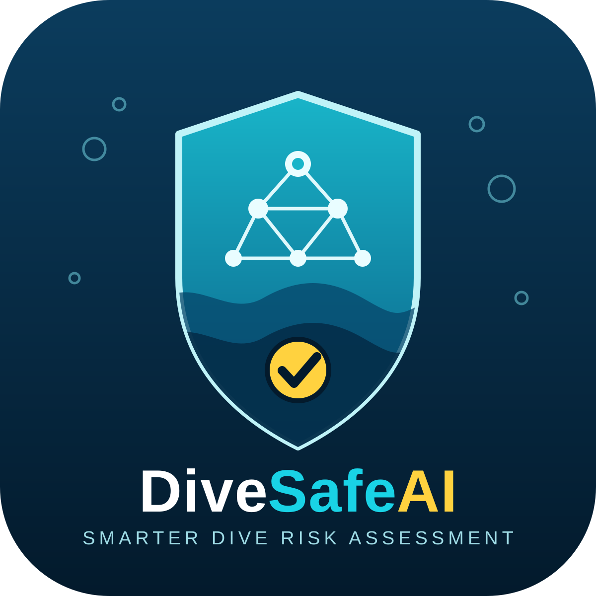
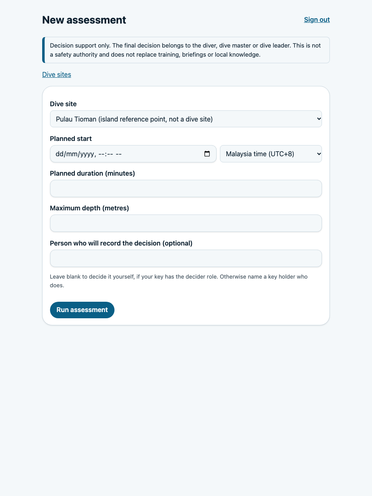
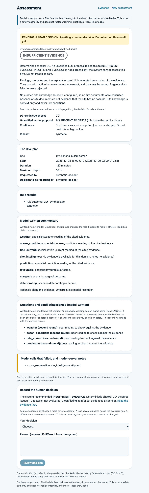
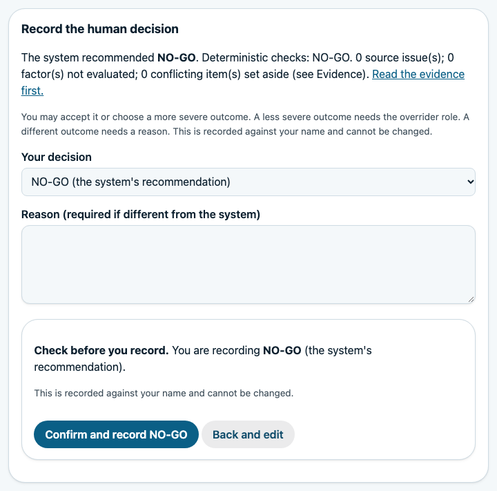
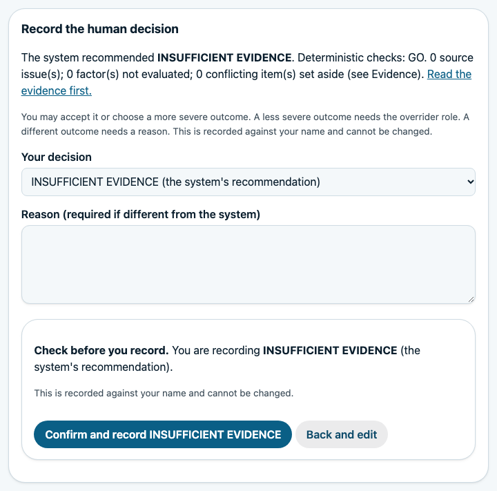
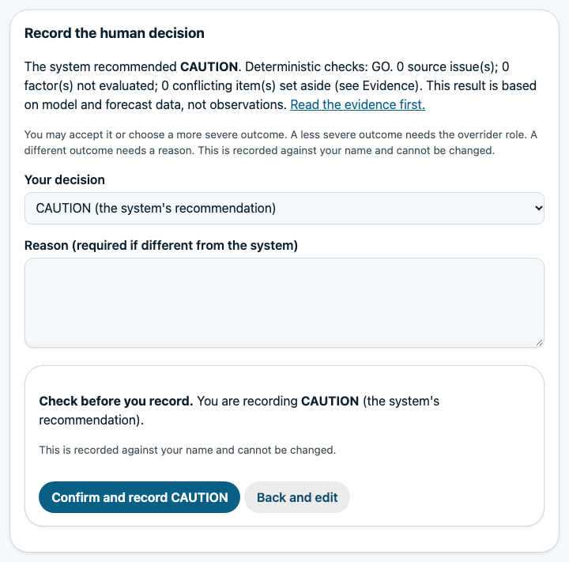
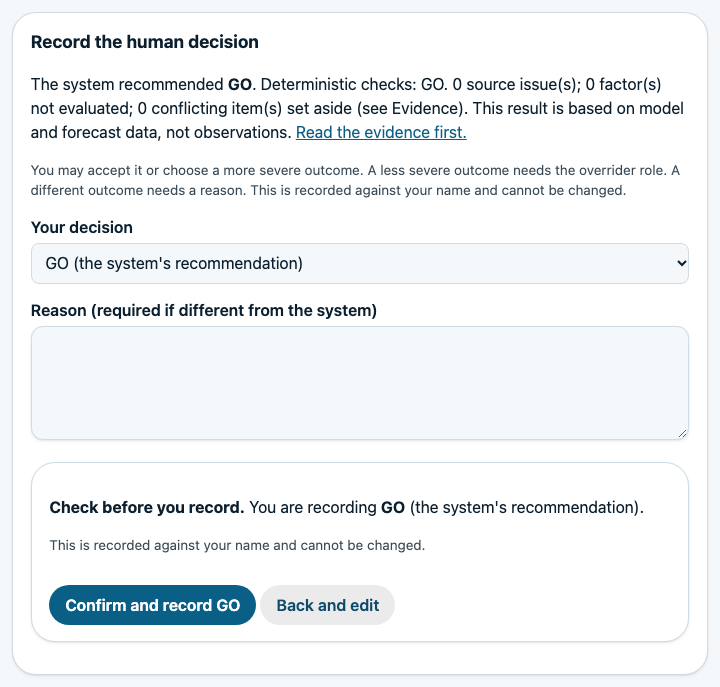
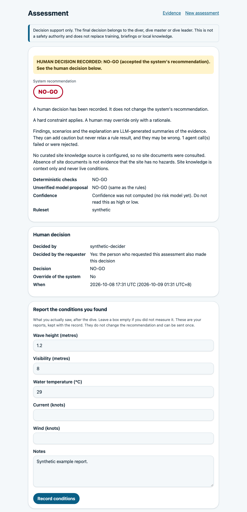
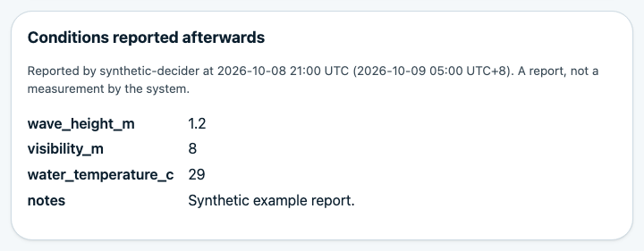
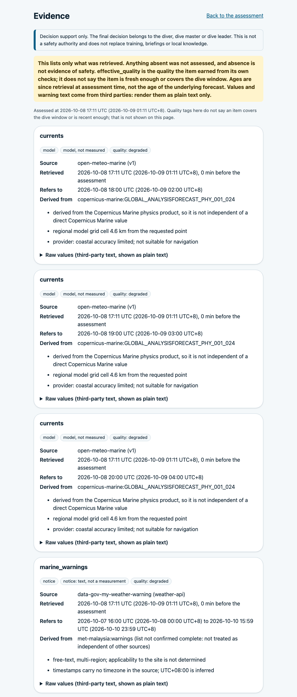

<p align="center">
  
</p>

# DiveSafe AI

Agentic environmental risk assessment and decision support for recreational diving.

DiveSafe AI combines weather, wind, waves/swell, currents, tides, sea temperature, marine
warnings, historical observations, dive-site knowledge and a user's dive plan into an
**explainable recommendation**: `GO`, `CAUTION`, `NO-GO` or `INSUFFICIENT EVIDENCE`.

> **Decision support only.** The final decision always belongs to the human diver, dive master
> or dive leader. DiveSafe AI is not a safety authority.

## Status

**Built.**

- The safety-critical core:
  - frozen domain types;
  - a fail-closed rules engine with `reconcile`;
  - the LLM provider abstraction and settings.
- Connectors for Pulau Tioman, Malaysia:
  - Open-Meteo marine and wind model data;
  - MET Malaysia warnings through data.gov.my, and the MET API marine forecast for the Tioman
    waters zone (in production since 2026-11-17);
  - tides.today tide predictions (Teluk Tekek: 3.7 km from the Tioman reference point, 13.4 km from
    the Tiger Reef dive site, position as published by PADI, as an owner-ordered proxy), which are
    DEGRADED (with `DIVESAFE_DEGRADED_MAY_SUPPORT_GO` on, as in production since 2026-11-22, a fresh
    prediction covering the dive window can satisfy the required `tides` category for GO or CAUTION,
    never as the sole source and read by no rule; ADR 0008 Amendment 2) and off by default; switched
    on in production by the owner on 2026-11-20 (ADR 0029, "Switched on"), under a permission that
    covers only that deployment; the full copyright notice is shown once with every assessment view
    that holds a tides.today item (evaluated or withheld), deduplicated; at most 4 notices, then a
    count ([ADR 0029](docs/adr/0029-tides-today-tide-predictions.md)).
- An evidence and provenance service.
- The pipeline, as a plain-Python stage graph (Observe, Retrieve, Assess, Reason, Rejudge,
  Propose, Supervise, Gate). It has a code-only Supervise stage and a per-stage trace on the
  record ([ADR 0025](docs/adr/0025-plain-python-orchestration.md)).
- The human decision gate.
- An authenticated FastAPI interface with asynchronous creation
  ([ADR 0019](docs/adr/0019-asynchronous-assessment-creation.md)).
- A PostgreSQL repository with migrations ([ADR 0012](docs/adr/0012-postgresql-assessment-repository.md),
  [ADR 0015](docs/adr/0015-schema-migrations.md)).
- A web UI ([ADR 0017](docs/adr/0017-web-ui.md)).
- An agent stage: five specialists, three bounded Tree-of-Thought scenarios and a risk proposal,
  through one OpenAI-compatible adapter ([ADR 0018](docs/adr/0018-openai-compatible-adapter.md)).

**Site knowledge (RAG, [ADR 0022](docs/adr/0022-rag-knowledge-retrieval.md) and
[ADR 0028](docs/adr/0028-knowledge-to-a-named-forwarding-host.md)).**

- Curated site documents are loaded, approved and withdrawn by hand with the knowledge loader
  ([docs/knowledge-loader.md](docs/knowledge-loader.md)). Each document carries its provenance,
  version and review date.
- The Retrieve stage reads the approved chunks for the site once per run, as KNOWLEDGE evidence.
  It is context only: never a live value, never a decision.
- Version 1 has no embeddings, ranking or search: it returns every approved chunk for the site,
  chosen in SQL. pgvector or full-text search would need a new ADR.
- By default no knowledge reaches a model. ADR 0028 allows approved knowledge to go to one named
  model host, and only for versions that attest to that.
- Production holds one owner-written document, `tioman-site-guide`, approved, attested and sent
  to the model host since 2026-11-15.
- Retrieved text is untrusted, delimited in prompts and cited by evidence id.

**In production.** On the owner's host, with the Docker stack of
[ADR 0024](docs/adr/0024-production-deployment-in-docker.md) (still marked proposed):

- the API, PostgreSQL with TLS, and the one-off knowledge-loader jobs;
- a hosted model through an OpenAI-compatible proxy;
- metadata-only tracing to a self-hosted Langfuse
  ([ADR 0027](docs/adr/0027-observability.md)), switched on 2026-11-16;
- a request id on every log line, in the `X-Request-ID` response header and on the run's trace
  span ([ADR 0027](docs/adr/0027-observability.md) item 1), deployed 2026-11-17;
- `/metrics` in the Prometheus text format, readable only by a key whose only role is `metrics`
  (no groups) ([ADR 0027](docs/adr/0027-observability.md) item 2), deployed 2026-11-17;
- Uptime Kuma (self-hosted, web UI on loopback only) watching `/health` and the daily backup,
  dashboard alerts only ([ADR 0027](docs/adr/0027-observability.md) item 3), set up 2026-11-17.

**Not built.**

- Reviewed rules: no dive professional has signed a limit, so every assessment is
  `INSUFFICIENT EVIDENCE` by design.
- The vendor-specific `openai` and `anthropic` adapters.
- Metric alerts and alert notifications (ADR 0027 item 3).
- Calibrated confidence.
- The agent stage has had only small live runs on synthetic scenarios (see
  [docs/evaluation-strategy.md](docs/evaluation-strategy.md)). With
  `DIVESAFE_LLM_PROVIDER=fake`, the default, it is off.

Marine data is Open-Meteo.com (CC BY 4.0, non-commercial use only), with wave models from DWD
and others.

## Safety hierarchy

1. Deterministic safety rules
2. Validated environmental data
3. Risk model
4. Agent reasoning
5. LLM-generated explanation

A lower layer can never relax a higher one. See [docs/architecture.md](docs/architecture.md).

## Sample pages

Screens from the web UI ([ADR 0017](docs/adr/0017-web-ui.md)). **These are not real
assessments.** A local stand-in API served records built by the offline test harness from
recorded provider data (October 2026), a scripted fake model and an invented
`synthetic-decider`. No production data was used and no live call was made. The model text is
the harness's placeholder wording.

The repository ships no validated rule. Without a signed-off ruleset, deployed separately, a
real assessment ends at `INSUFFICIENT EVIDENCE` (or `NO-GO` if a model proposal raises it) and
lists the factors it could not evaluate; `GO` or `CAUTION` needs a `VALIDATED` rule for every
required factor (see [docs/risk-model.md](docs/risk-model.md)). The `GO` and `CAUTION` samples
exist only because the test harness uses a rule that returns `GO` for any input (`synthetic.go`,
not a signed-off limit), lets model and forecast data support it, and requires no factors. That
is also why every sample shows "0 factor(s) not evaluated".

The recorded marine data come from [Open-Meteo](https://open-meteo.com/) (CC BY 4.0; currents
and sea temperature derived from Copernicus Marine), and the marine warnings from MET Malaysia
via data.gov.my.

<details>
<summary>1. Starting a new assessment</summary>

The dive site, planned start, duration, maximum depth and, optionally, the person who will
record the decision.


</details>

<details>
<summary>2. The completed assessment: rules, model commentary and conflicting signals</summary>

The result is pending until a human decides. The page shows the deterministic checks and the
unverified model proposal, which can only make the result stricter. It also lists the rule
results, the model-written commentary, the model's questions and conflicting signals, and the
model calls that failed. The decision form comes last.

In this sample the test rule returns `GO` and the scripted model proposes
`INSUFFICIENT EVIDENCE`, so "Deterministic checks: GO" with a stricter result is expected here.
A model can never relax a rule result, and a model alone can never produce `GO`.


</details>

<details>
<summary>3. The human decision: NO-GO, INSUFFICIENT EVIDENCE, CAUTION and GO</summary>

Each form accepts the system's recommendation and is shown at the "check before you record"
step; overrides are not shown. A decision is written once and cannot be changed. A different
outcome needs a reason, and a less severe one also needs the overrider role. The `NO-GO` comes
from a test rule that returns `NO-GO`. No shipped rule returns `NO-GO`, so a real `NO-GO` comes
from a signed-off rule in a deployed ruleset or from a model proposal; when a model raised it,
"Deterministic checks" shows a less severe result. The `INSUFFICIENT EVIDENCE` form is the sample
from section 2. The `CAUTION` and `GO` forms cannot occur without such a ruleset; see above.
The `NO-GO` assessment in section 4 predates a wording change: the page now says a less severe
outcome needs a reason and the overrider role, as the form does.





</details>

<details>
<summary>4. Recording the conditions found</summary>

After the decision and the planned start, the person can report the conditions they actually
found. The report is kept with the record and never changes the recommendation. The reported
values here are invented and are not compared with any limit.



</details>

<details>
<summary>5. The evidence behind an assessment</summary>

Each evidence item shows its kind, quality, source, retrieval time, validity window and how it
was derived. It also shows the raw provider values as plain text. The image shows the first
four items.


</details>

## Quick start

```bash
python3 -m venv .venv && source .venv/bin/activate
pip install -e ".[dev]"
cp .env.example .env
pytest                      # all tests (offline; uses recorded fixtures)
pytest -m safety            # safety-hierarchy tests only
ruff check . && mypy        # lint and types
uvicorn divesafe.api.app:create_app --factory --reload
```

> **Upgrade note (ADR 0023):** a loopback model server (`openai_compatible`) now needs
> `DIVESAFE_LLM_SERVER_IS_LOCAL=true` or `DIVESAFE_ALLOW_EXTERNAL_LLM=true`, or the application
> refuses to start. The default (`fake`) is unaffected.

With Docker (API + PostgreSQL/pgvector):

```bash
docker compose -f docker/docker-compose.yml --env-file .env up --build
```

That is a development stack only. For the production stack see "In production" above and
[docs/first-run-on-the-real-host.md](docs/first-run-on-the-real-host.md). Backing up and
restoring its database: [docs/backup-and-restore.md](docs/backup-and-restore.md).

> **macOS note:** if `import divesafe` stops working in the venv, macOS may have flagged the
> editable-install `.pth` file as hidden. Run `chflags -R nohidden .venv`. `pytest` is
> configured with `pythonpath = ["src"]` and is unaffected.

## API (development)

```bash
export DIVESAFE_AUTH_MODE=dev DIVESAFE_EVIDENCE_MAX_AGE_MINUTES=60 DIVESAFE_DECISION_MAX_AGE_MINUTES=120
uvicorn divesafe.api.app:create_app --factory --port 8000 --no-proxy-headers
curl -X POST localhost:8000/v1/assessments -H 'X-Dev-Actor: me' -H 'content-type: application/json' \
  -d '{"site_id":"my-pahang-pulau-tioman","planned_start":"<future UTC time>","planned_duration_minutes":90,"max_depth_m":18}'
```

| Endpoint | Purpose |
| --- | --- |
| `GET /health` | Liveness (no auth) |
| `GET /v1/sites`, `GET /v1/sites/{id}` | The known dive sites |
| `POST /v1/assessments` | Start an assessment: returns `202` and a `Location`; poll it until the `PENDING_HUMAN` assessment is there |
| `GET /v1/assessments/{id}` | Read an assessment (or the run status while it runs) |
| `GET /v1/assessments/{id}/evidence` | The evidence behind an assessment, with provenance |
| `POST /v1/assessments/{id}/decision` | Human accepts or overrides (rationale required for overrides) |
| `POST /v1/assessments/{id}/reassign` | Admin moves a pending assessment to another decider |
| `POST /v1/assessments/{id}/actual-conditions` | Post-dive conditions (after a decision, once) |

Without `DIVESAFE_EVIDENCE_MAX_AGE_MINUTES` the create endpoint returns 503: there is no default
evidence age. Outside development use `DIVESAFE_AUTH_MODE=api_key` with
`DIVESAFE_API_KEY_HASHES` (see `.env.example`). Each key has an actor name and explicit roles:
viewer, assessor, decider, overrider (may choose a less severe outcome,
[ADR 0026](docs/adr/0026-conflicting-evidence-and-roles.md)) and admin, plus optional `groups`
that scope what a viewer may read. Requests are rate limited per actor
([ADR 0013](docs/adr/0013-roles-and-rate-limits.md)). Without `DIVESAFE_DATABASE_URL` records are in
memory only and are lost on restart ([ADR 0006](docs/adr/0006-api-auth-and-repository.md)).

## Documentation

| Doc | Contents |
| --- | --- |
| [docs/project-brief.md](docs/project-brief.md) | Purpose, scope, non-goals |
| [docs/architecture.md](docs/architecture.md) | Components, lifecycle, safety hierarchy |
| [docs/authority-map.md](docs/authority-map.md) | Who may write what, and which test proves it |
| [docs/agent-design.md](docs/agent-design.md) | Agents and the orchestrator |
| [docs/rag-design.md](docs/rag-design.md) | RAG scope and the live-data separation |
| [docs/knowledge-loader.md](docs/knowledge-loader.md) | Loading, approving and withdrawing site knowledge in production |
| [docs/tot-design.md](docs/tot-design.md) | Bounded Tree-of-Thought scenario evaluation |
| [docs/risk-model.md](docs/risk-model.md) | Rules engine, risk model, reconciliation |
| [docs/data-sources.md](docs/data-sources.md) | Source categories and connector contract |
| [docs/evaluation-strategy.md](docs/evaluation-strategy.md) | How the system is tested and evaluated |
| [docs/first-run-on-the-real-host.md](docs/first-run-on-the-real-host.md) | Setting up and checking the production stack |
| [docs/backup-and-restore.md](docs/backup-and-restore.md) | Backing up and restoring the production database |
| [docs/domain-validation/](docs/domain-validation/README.md) | Pack for a dive professional to supply sourced, signed-off safety limits |
| [docs/adr/](docs/adr/) | Architecture decision records |

Contributor and AI-agent rules are in [AGENTS.md](AGENTS.md).
